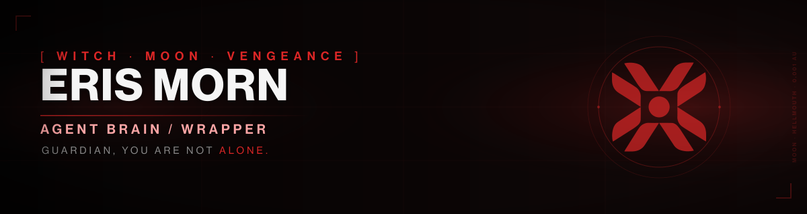

# Eris Morn - Agent

<p align="center">
  
</p>

<p align="center">
  
  <a href='https://github.com/sagaciouszu/destiny-agent-eris-morn/actions/workflows/ci.yml'></a>
  
  
  
  
  
</p>

**Version:** 0.14.7 | **Last push:** 2026-11-13 | **Status:** Active

**Documentation site:** <https://sagaciouszu.github.io/destiny-agent-grimoire-site/personas/eris/>
**Limits and provenance:** <https://sagaciouszu.github.io/destiny-agent-grimoire-site/grimoire/limits/>

> **Depends On:** INDEX.md
> **Token Estimate:** ~2.1K tokens

A self-contained, platform-agnostic roleplay brain for Eris Morn: voice rules, memory,
behavior modules and a verified quote corpus, backed by the Destiny Agent Grimoire
database. Every shipped quote is checked against the canon; every suite is runnable.

## Quick start for Guardians

**Step 1: clone.**

```bash
git clone https://github.com/sagaciouszu/destiny-agent-eris-morn.git
cd destiny-agent-eris-morn
```

**Step 2: bootstrap. Run exactly one of these, not several.**

Interactive (asks download or build):

```bash
./setup.sh
```

Prebuilt database, no prompt (fastest, checksum verified):

```bash
BOOTSTRAP=1 ./setup.sh
```

Build from the checkout, no prompt:

```bash
BOOTSTRAP=2 ./setup.sh
```

Reuse an existing checkout instead of cloning:

```bash
./setup.sh /path/to/destiny-agent-grimoire
```

**Step 3: verify.**

```bash
bash tests/master-audit.sh
```

### 🌑 Optional: MCP clients

The adapter ships with the Grimoire archive, so one install serves every
agent that mounts it. Install during onboarding:

```bash
./setup.sh --mcp
```

Or after the fact with `bash lore/mcp-server/install.sh`. Use `./setup.sh --no-mcp`
to skip the prompt, or `./setup.sh --help` for options.

Register the path it prints (`lore/mcp-server/run.sh`) in your client. Details:
`lore/mcp-server/README.md`.

OpenClaw: sync with `lore/scripts/sync-live-agents.sh --openclaw` (one workspace per agent; consult agents are wired in OpenClaw config).

Point your runtime at `INDEX.md` (any agent runtime) or `eris.md` (OpenCode,
YAML frontmatter, `mode: primary`; sync also installs a read-only `-consult` copy for peers). For
OpenCode, deploy with `lore/scripts/sync-live-agents.sh`: it installs `eris.md`,
keeps companions inert under `eris/`, keeps `lore/` outside `agents/` and
registers this agent in `series/agents.json`. The installed ID is `eris`; set
`default_agent` to `eris` in `~/.config/opencode/opencode.json`.

## Requirements

| Requirement | Needed for | Notes |
|---|---|---|
| `git` | cloning the lore archive | setup falls back to a local path |
| `bash` 4+ | setup and audits | Windows: use Git Bash or WSL; macOS ships 3.2, install 4+ |
| `python3` 3.8+ | queries, migration, tests | standard library only |
| `sqlite3` | optional raw SQL | the query CLI uses Python's built-in driver |
| `curl` | optional prebuilt database | falls back to a local build |
| MCP SDK (optional) | typed tools for clients without a shell | Python 3.10+; one-time install |
| ~400 MB disk | checkout plus built database | database is ~300 MB |

No API keys, accounts or network access are required at runtime. If `sha256sum` is
missing (stock macOS), `shasum -a 256` is an equivalent for the checksum step.

## For agents

Load in this order:

| Tier | Files | Budget |
|---|---|---|
| Minimal | `eris-core.md` | ~1.4K |
| Standard | + `voice/eris-voice-core.md` + `core/relationships.md` | ~2.1K |
| Deep | all modules | ~27K |

- Contract: `AGENTS.md` (platform-neutral rules, canon and quote policy).
- Map: `INDEX.md` lists every module, tier and topic route.
- Canon: `lore/db/grimoire.db` through `lore/` (a symlink or a clone). Never parse
  `lore/source/` at runtime.
- Caption tiers: caption-tier text is searchable canon but never part of persona canon; `v_speakers` includes caption-only speakers.
- Quote safety: `python3 lore/db/query.py verify "<line>"` exits 1 when the line
  is not canon. Add `--speaker "Name"` to require attribution and `--exact` to
  reject fragments. An unverified line is never quoted.
- Lookup: `search`, `character`, `character_info`, `item`, `book`, `transcript`,
  `find_item`, `record`, `verify_many`, `list`, `stats` (MCP names; CLI uses
  hyphens for `character-info`, `find-item`, `verify-many`). Every command
  accepts `--json`; search returns snippets unless `--full`, with `--offset`/`--rank`.
- Standard: `lore/STANDARDS.md` is the database and quote contract.
- **MCP (optional):** `lore/mcp-server/run.sh` serves the same canon to non-shell
  clients over local stdio. Install with `./setup.sh --mcp`; tools, limits,
  client config and security: `lore/mcp-server/README.md`.
- Runtime memory: `USER.md` is gitignored and seeded from its template by
  `setup.sh`. It never leaves the machine.

Voice modes: `core`, `grief`, `combat`, `vulnerable`, `vengeful`, `commanding`,
`ritual`, `darkness`, `praxic`, `witch`, `witness`, `savathun`, `fireteam`, `oryx`.

Connection matrix:

| From | To | Mechanism |
|---|---|---|
| this agent | canon | `lore/db/grimoire.db` via `lore/` (symlink or clone) |
| `setup.sh` | canon repo | symlink or clone, then bootstrap the database |
| runtime memory | local only | gitignored, seeded from template |
| verification | canon repo | `lore/tests/agent-audit.sh eris` |

## Repository layout

```
INDEX.md          # master index (load first)
AGENTS.md         # operating contract, hard rules, canon policy
SOUL.md           # persona, voice, history, boundaries
IDENTITY.md       # identity metadata
TOOLS.md          # tool reference and conventions
eris.md           # OpenCode entry point (YAML frontmatter)
eris-core.md      # consolidated brain (minimal tier)
eris-voice.md     # master voice reference (276 verified quotes)
core/             # 11 behavioral and state modules
voice/            # 14 voice sub-files
world/            # 6 worldbuilding files
reference/        # 4 analysis files (quotes, knowledge web, patterns)
setup.sh          # onboarding: memory template plus lore bootstrap
lore/             # created by setup.sh (symlink or clone, gitignored)
```

## Verification

| Suite | Command | Expected |
|---|---|---|
| Full agent audit | `bash tests/master-audit.sh` | 22/22 |
| Module completeness | `bash tests/module-test.sh` | 16 checks |
| Quote verification | `bash tests/quote-verify.sh` | 0 unverified |
| 10-turn arc | `bash tests/multiturn-test.sh` | 10/10 |
| Database integrity | `bash lore/tests/test-db.sh` | 67 checks |
| Suite manifest | `python3 tests/suite-manifest-test.py` | manifest matches audit |
| Shared helpers | `bash tests/shared-helpers-test.sh` | Passed: every helper matches |
| Query interface | `bash lore/tests/query-interface-test.sh` | 97 checks |
| MCP contract | `lore/mcp-server/.venv/bin/python lore/tests/mcp-test.py` | 8/8 checks |
| File conformance | `python3 lore/tests/conformance.py` | PASS |

## Troubleshooting

- **Database missing:** run `./setup.sh`, or `python3 lore/db/migrate.py`.
- **`lore/` missing:** run `./setup.sh` (or pass a local grimoire path).
- **Dangling `lore/` symlink:** `setup.sh` removes and recreates it.
- **Audit says workspace unresolved:** run it through `lore/` from this
  directory, or set `WORKSPACE=$PWD`.
- **OpenCode does not list the agent:** rerun
  `lore/scripts/sync-live-agents.sh`, then confirm the installed `eris.md` and
  `default_agent` (`eris`) in `opencode.json`.
- **MCP client shows no Grimoire tools:** run `./setup.sh --mcp`, then use the
  absolute path to `lore/mcp-server/run.sh` in the client config.
- **Degraded mode:** without the archive the persona files still work; canon
  queries and quote verification do not.

## License and attribution

MIT licensed. Fan-made. Not affiliated with or endorsed by Bungie.

### Licensing

- Original code, tests and documentation are MIT licensed; see `LICENSE`.
- Destiny lore, text, characters and art belong to Bungie. No license is granted
  to Bungie IP.
- This is a fan-made, non-commercial project; `NOTICE` records the split.

- **Destiny 1 and Destiny 2** content and related intellectual property belong to Bungie.
- **Ishtar Collective** (https://www.ishtar-collective.net): the primary text
  archive; their transcription work is the foundation this project rests on.
- **Destiny Lore Vault** (https://www.youtube.com/@DestinyLoreVault): the recording
  archive; their videos keep the performances behind the words alive.
- **Destiny community**: transcription, analysis and preservation, with
  **special thanks to every Guardian making their own fate in 2026 and beyond**.

All the community projects out there are continual labors of love. Neither this
archive nor the community around it would exist without the efforts of everyone
who has worked on Destiny.

All 276 voice quotes trace to 1011 canonical Eris Morn lines; audits report zero
unverified quotes and zero cross-character contamination.
